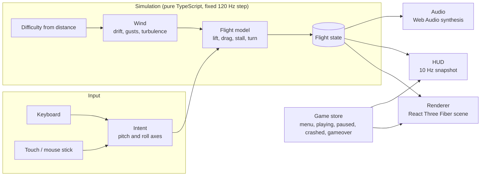

# Paper Plane

**Fold, throw, ride the wind.** A browser game about keeping a paper plane in the air for as long as you can.

You fly a paper dart through an open sky from a camera just behind it. You only control pitch and bank, but the plane obeys a small flight model: pull up too hard and it stalls, dive too long and it overspeeds, bank and it turns but sinks. The wind drifts, gusts and eventually storms. Your score is the distance you cover before you hit the ground.

Play it locally with the steps under [Getting started](#getting-started), or put it online with the notes under [Deployment](#deployment).

> **Good to know.** Everything runs in your browser. Your best flight and settings are saved in your browser's local storage only, so they do not follow you between devices. Sound starts after your first click or key press, because browsers require that.

---

## What you can do

### Launch

- A boy on a hilltop holds the plane behind the menu. Press **Start** and he winds up and throws it. Press any flight key or tap to throw right away.
- The flight begins from his hand, so a dive straight after the throw ends on the hill.

### Fly

- Hold **W** or **Up** to climb, **S** or **Down** to descend.
- Hold **A** / **D** or **Left** / **Right** to bank and turn.
- On a phone or with a mouse, press anywhere and drag: up to climb, sideways to turn.
- Let go and the plane settles back toward level flight on its own.

### Read the wind

- The pill in the top right shows the wind's direction and strength from the plane's point of view, and lights up during a gust.
- Thin streaks in the air show how fast you are moving and which way the wind pushes.
- Clouds drift with the wind. The sky changes from clear to cumulus, golden hour, overcast and storm as you go further, and the wind gets rougher with it.

### Dodge and collect

- Hot-air balloons drift across your path and wind turbines stand on the ground with spinning blades. Hit either and the flight is over.
- Fly through a glowing ring for a 100 m bonus. The HUD counts your rings and the score card lists them.
- Obstacles start about 250 m in and get denser the further you fly.

### Watch the instruments

- The number at the top is your distance, with your flight time under it. It turns gold once you pass your best.
- The bar on the left is your altitude.
- The ball at the bottom left shows pitch and bank. The strip under it is your stability: green is calm, amber means you are near a stall or overspeed, red means act now.
- Warnings appear in the middle of the screen when you are stalling, slow, or too fast.

### Crash, score, go again

- Hit the ground, a balloon or a turbine and you get a short crash, then a card that names what you hit and shows your distance, time, highest altitude, stability, rings and best.
- Press **Space** or tap **Fly again** to restart immediately. **R** restarts at any time.
- **Space**, **P** or **Esc** pauses. Switching tabs pauses too.

### Tune it to your device

- Sound on or off with **M** or the checkbox on the menu and pause screens.
- Quality is picked automatically from a short frame-time check at startup. You can force high, medium or low from the same settings row.
- Reset your best from the menu.

---

## How it works



1. **Every frame**, the driver adds the elapsed time to an accumulator and runs the simulation in fixed 1/120 s steps. The renderer interpolates between the last two states, so the flight looks the same at 30, 60 or 144 frames per second.
2. **The flight model** works out the plane's angle of attack from its pitch and the air flowing past it, turns that into lift and drag, and adds gravity and a small forward breeze. Pitch and roll change through moments, never directly, so nothing snaps. Lift collapses past the stall angle; bank tilts the lift so turns cost height.
3. **The wind** is three slowly drifting channels (head or tail, up or down, cross) plus timed gusts and a turbulence level, all scaled by how far you have flown.
4. **The game store** holds the phase and your best score. The frame driver only steps the simulation while playing, flies the plane by itself behind the menu, and turns a crash into the score card after a short beat.
5. **The scene** keeps the plane at the origin and moves the world past it. Clouds, wind streaks and obstacles live in fixed pools and are recycled ahead of the plane. One palette table drives the sky dome, fog, lights and cloud tint, so the stages blend without seams.
6. **Terrain and obstacles** are part of the simulation: one height function shapes the launch hill and decides ground crashes, and an obstacle field spawns balloons, turbines and rings ahead of you and checks collisions against simple shapes. The renderer only draws what the simulation says is there.
7. **Audio** is synthesised: filtered noise for wind, a swish for the throw, a pulsing tone for the stall warning, bursts for crash and thunder. No audio files.

---

## Tech stack

| Area | What |
|---|---|
| UI | [React 19](https://react.dev/) with TypeScript |
| 3D | [Three.js](https://threejs.org/) through [React Three Fiber](https://docs.pmnd.rs/react-three-fiber) |
| State | [Zustand](https://zustand-demo.pmnd.rs/) for game phase and settings |
| Physics | Custom arcade flight model in [src/sim](src/sim), no physics engine |
| Audio | [Web Audio API](https://developer.mozilla.org/docs/Web/API/Web_Audio_API), synthesised at runtime |
| Build | [Vite 7](https://vite.dev/) |
| Tests | [Vitest](https://vitest.dev/) for the simulation, scoring, state machine and input maths |
| Lint | [ESLint 9](https://eslint.org/) with typescript-eslint and react-hooks |

All art is generated in code: the paper dart geometry, paper texture, cloud shapes, sky, ground, the hill, the boy and the obstacles. The only image files are the favicon, the home-screen icons and the social card, all rendered from the game itself.

---

## Getting started

You need [Node.js](https://nodejs.org/) 20 or newer and a browser with WebGL 2.

```bash
git clone <your-fork-url> paper-plane
cd paper-plane
npm install
cp .env.example .env.local   # optional, nothing is required
npm run dev
```

Open the address Vite prints (usually http://localhost:5173).

### Environment variables

| Variable | Needed for | Notes |
|---|---|---|
| `BASE_PATH` | Hosting under a sub-path | Build time only. Leave empty for the site root. GitHub Pages project sites need `/<repo-name>/`. |
| `SITE_URL` | Absolute links in the social-card tags | Build time only, no trailing slash. Filled automatically on Vercel from the deployment URL; set it for other hosts. |

There are no secrets.

### Scripts

| Command | What it does |
|---|---|
| `npm run dev` | Start the dev server with hot reload |
| `npm run build` | Production build into `dist/` |
| `npm run preview` | Serve the production build locally |
| `npm run typecheck` | TypeScript, no emit |
| `npm run lint` | ESLint over `src/` |
| `npm test` | Vitest suite |
| `npm run tune` | Headless flight scenarios that print how the model behaves |
| `npm run check` | Typecheck, lint, test and build in one go |

### Dev tricks

- Press the backtick key in game for a panel with every flight variable, draw calls, a wind override and a difficulty override.
- In dev mode the URL accepts `?phase=playing`, `?phase=launching&launchHold=0.6`, `?hold=up,right`, `?skip=5` and `?progress=0.8` to jump straight into a situation. They are stripped from production builds.
- To re-render the social card, open `/?og=1&phase=playing&skip=44&hold=right` on the dev server in a 1200x630 window and screenshot it to `public/og.png`.

---

## Project structure

```text
paper-plane/
├── docs/                 # Architecture, flight model, assets, milestones, testing
├── public/               # Favicon
├── scripts/tune.ts       # Headless scenario harness (npm run tune)
└── src/
    ├── sim/              # Pure TypeScript simulation: flight, wind, difficulty, scoring, loop
    ├── state/            # Zustand game store, live sim handle, HUD snapshot
    ├── input/            # Keyboard, virtual stick, intent smoothing
    ├── scene/            # React Three Fiber: plane, camera, sky, clouds, streaks, lighting
    ├── ui/               # HUD, menu, pause, game over, settings, debug panel, styles
    ├── audio/            # Web Audio synthesis engine
    └── utils/            # Maths, formatting, quality tiers, local storage
```

---

## Deployment

The build is static files. Any static host works.

- **Vercel** (recommended, and the quickest way to test on a phone):
  1. Push the repository to GitHub, GitLab or Bitbucket.
  2. On [vercel.com](https://vercel.com) choose **Add New Project**, import the repository and press **Deploy**. The included [vercel.json](vercel.json) sets the Vite framework, `npm run build`, the `dist` output and long cache headers for hashed assets. No environment variables are needed; the social-card links pick up the deployment URL on their own.
  3. Open the `*.vercel.app` link on your phone. Add it to the home screen for a full-screen, landscape experience; the manifest and icons are included.
  Alternatively, from this folder: `npx vercel` to preview, `npx vercel --prod` to publish.
- **Netlify**: import the repository, build command `npm run build`, output directory `dist`. Set `SITE_URL` to the site's URL so social cards link correctly.
- **GitHub Pages**: push to `main` with the included workflow in [.github/workflows/deploy.yml](.github/workflows/deploy.yml). It builds with `BASE_PATH=/<repo-name>/` and publishes `dist`. Enable Pages with source "GitHub Actions" in the repository settings first.
- **Anything else**: run `npm run build` and upload `dist/`. If the site is not at the domain root, set `BASE_PATH` before building.

This folder is not a git repository yet. Run `git init`, commit, and add a remote before using the workflow.

---

## Status and limits

- The main loop has been played in Chrome from the production build, and the simulation, scoring, state machine and input maths are covered by automated tests. See [docs/TESTING.md](docs/TESTING.md) for the matrix.
- Firefox, Safari and real phones have not been tested by the author yet. The code uses only standard WebGL 2, Pointer Events and Web Audio, but check before you ship.
- Balancing is first-pass. Difficulty ranges and obstacle density live in [src/sim/constants.ts](src/sim/constants.ts). Turbine blades collide as a solid disc, which is forgiving to compute but may feel harsh; it is one constant to soften.
- Changing quality mid-game applies resolution and cloud counts at once, but antialiasing only changes after a reload.
- Wind is expressed relative to the plane, so turning never changes what you feel. This is intentional, to keep a downwind heading from being the only strategy.
- Three.js is about 180 kB gzipped on its own; the rest of the game is around 145 kB.
- No gamepad support, no online leaderboard.

---

## Security

- No backend, no accounts, no network requests after the page loads.
- The only data stored is your best flight and settings, in `localStorage` under `paperplane.best.v1` and `paperplane.settings.v1`. Both are validated when read.
- No secrets exist in the project. `.env.example` lists the single optional build variable.
