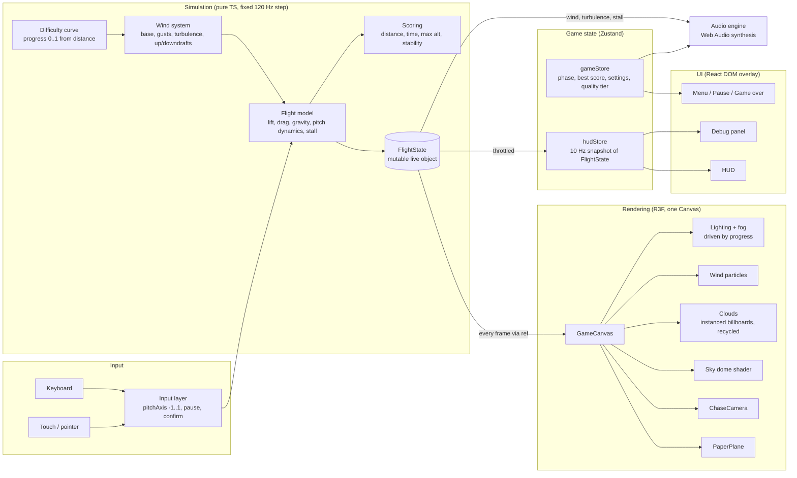
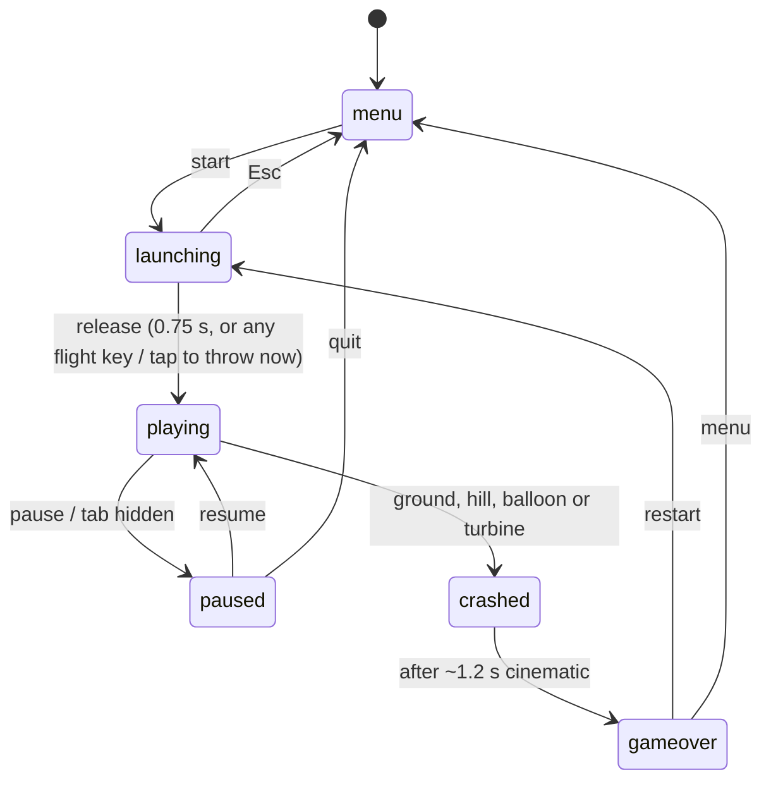

# Paper Plane — Technical Architecture

Status: Milestone 0 (planning). No game code exists yet.

This document is the reference for how the game is built. Later milestones must
read it before changing anything and update it when a decision changes.

---

## 1. What we are building

A browser-based 3D arcade endless flyer. A folded paper plane flies forward
continuously, seen from a chase camera behind and above. The player controls
only pitch (up / down). Wind changes constantly and is the main source of
difficulty. The score is distance flown before crashing. The loop is
start, fly, crash, read score, restart in seconds.

Non-negotiable: the flight must feel physical. Input changes pitch *rate*, never
position. Climbing bleeds speed and can stall. Diving gains speed and becomes
unstable. Neutral input recovers slowly toward trim. Stalls come out of the
simulation, never from a random roll.

---

## 2. Technology stack

| Area | Choice | Why |
|---|---|---|
| Language | TypeScript (strict) | Physics code benefits from types; shared types between sim, scene and UI |
| Build | Vite | Fast dev server, simple static production build |
| UI framework | React 19 | Menus, HUD, overlays |
| 3D | Three.js via React Three Fiber (R3F) + Drei | Declarative scene graph, good ecosystem, no engine lock-in |
| State | Zustand | Tiny, works outside React (needed for per-frame code) |
| Physics | Custom arcade flight model (own code) | A rigid-body engine does not model lift, stall or wind well and adds bundle weight |
| Audio | Web Audio API, synthesised | Wind is filtered noise; no audio files needed to ship |
| Tests | Vitest | Unit tests for the simulation, which is pure TypeScript |
| Hosting | Static files (Vercel / Netlify / GitHub Pages) | No backend; best score lives in localStorage |

Rejected for now: Rapier/Cannon (no need), `@react-three/postprocessing`
(deferred to Milestone 4, high quality tier only), Howler (Web Audio is enough),
HDRI skies (gradient shader sky is cheaper and animates with progression).

---

## 3. Layered architecture

The core rule: **the simulation is plain TypeScript and imports nothing from
React or Three.js.** Rendering reads from the simulation; it never writes to it.



### 3.1 Simulation layer (`src/sim/`)

- Owns `FlightState`, the single source of truth for the plane and the wind.
- Runs at a **fixed timestep of 1/120 s** using an accumulator. The accumulator is
  capped at 0.25 s so a tab switch does not cause a burst of catch-up steps.
- Exposes `step(dt, input)` and `reset(seed)`.
- Uses a **seeded random generator** (mulberry32) so test runs are reproducible.
- All tunable numbers live in one file, `constants.ts`, grouped and commented.
- See `docs/FLIGHT_MODEL.md` for the equations.

### 3.2 Game state (`src/state/`)

Two stores, deliberately split:

- `gameStore`: discrete state that changes rarely. Phase, best score, last
  result, settings, quality tier. Its actions are the only way to change
  phase: `startFlight`, `pause`, `resume`, `quitToMenu`, `crash`, `finish`.
  React components subscribe to this normally.
- `hudStore`: a snapshot of the live `FlightState` written **at most 10 times per
  second**. The HUD subscribes to this. This keeps React re-renders off the
  frame path.

Per-frame data never goes through React state. The scene reads the live
`FlightState` object directly inside `useFrame`.

### 3.3 Rendering (`src/scene/`)

- One R3F `<Canvas>`. No postprocessing by default.
- **Floating origin.** The plane is rendered at the ground origin and the
  world moves past it. Render space is world-aligned (it does not rotate
  with the heading): every environment object stores a world position and is
  rendered at `(world - planeWorld)`. This avoids float precision loss on
  long flights.
- Three.js is Y-up. Heading 0 flies toward **-Z**; turning right heads
  toward +X. Sim ground coordinates are `posX` (right) and `posZ` (forward),
  so sim `posZ` maps to render `-z`. Sim altitude maps to render `y`.
- **Clouds** are a fixed pool of instanced billboards in three depth layers
  (far, mid, near). When an instance passes behind the camera it is respawned
  ahead with new size, height and opacity. Nothing is allocated during play.
- **Sky** is a shader dome: gradient keyed by the view ray's elevation plus a sun
  disc. Colours are interpolated from a palette table indexed by journey
  progress (clear, cumulus, golden hour, overcast, storm).
- **Ground** is a flat fogged disc at `y = 0` so the horizon and altitude read
  clearly. Crash happens when altitude reaches zero.
- **Chase camera**: target offset behind and above the plane, partially
  rotated by pitch, offset sideways by bank. Smoothed with
  frame-rate-independent exponential damping `1 - exp(-k * dt)`. Looks at a
  point ahead of the plane. Mild FOV increase with airspeed. Shake amplitude
  from turbulence.
- **Colour pipeline.** Standard materials (plane, ground) are ACES tone mapped
  with sRGB output. The sky dome and cloud shaders output sRGB *without* tone
  mapping because three.js applies scene fog after tone mapping using the raw
  fog colour; the dome's horizon colour must equal the fog colour or a band
  shows where the fogged ground meets the sky. Any future palette change must
  update the fog colour and the dome horizon together.

### 3.4 Input (`src/input/`)

Produces one intent object regardless of device:

```
{ pitchAxis: -1..1, rollAxis: -1..1, pausePressed, confirmPressed }
```

- Keyboard: W / ArrowUp = climb (+1), S / ArrowDown = descend (-1). A /
  ArrowLeft = roll left, D / ArrowRight = roll right. Opposite keys held
  = 0. Space / P / Escape = pause. Space / Enter = confirm on overlays.
- `preventDefault` on Space and arrows so the page never scrolls.
- Touch: a virtual stick. Press anywhere and drag; up climbs, sideways
  rolls, with a deadzone and a saturation radius (`input/stick.ts`). Pointer
  events, so a mouse drag works the same way. The stick's analogue axes are
  added to the key axes before smoothing.
- `visibilitychange` hidden = auto-pause. M toggles sound.

### 3.5 UI (`src/ui/`)

Plain React DOM positioned over the canvas. Menu, pause, game-over, HUD,
touch controls, debug panel. HUD values come from `hudStore`.

### 3.6 Audio (`src/audio/`)

Web Audio graph created on first user gesture (browser autoplay rule).
Wind = white noise into a band-pass filter whose cutoff and gain follow relative
airspeed and gust strength. Turbulence = low-frequency amplitude modulation.
Stall warning = soft oscillator tone with rising pulse rate. Crash = short
noise burst with fast decay. Menu clicks = tiny sine blips. No audio files.

---

## 4. Game states



`menu` shows the boy on the hilltop holding the plane while the camera
orbits slowly; the simulation is at rest. `launching` plays the wind-up and
throw; on release the frame driver hands the hand's world position to
`simulation.launchFrom` and the flight begins from there with the throw
velocity. `crashed` is a short non-interactive beat (1.2 s) before the score
card. Restart resets the simulation with a new seed and goes back to
`launching`. There is no loading step between runs.

The launch pose is shared through `state/live.ts` (`launch`): `<Boy />`
writes the hand's render-space position and orientation every frame, the
plane follows it while `launch.active`, and the store converts it to a sim
position on release.

---

## 5. Coordinate and unit conventions

- Units: metres, seconds, radians inside the sim. The HUD converts to degrees
  and km/h.
- Pitch positive = nose up. Pitch axis input positive = climb.
- Wind horizontal positive = tailwind (pushes the plane forward). Negative =
  headwind. Vertical positive = updraft.
- Progress `p` is `clamp(distance / FULL_DIFFICULTY_DISTANCE, 0, 1)` and drives
  both difficulty and environment, so they always agree.

---

## 6. Performance plan

| Concern | Approach |
|---|---|
| Per-frame React work | None. Live state in a mutable object; HUD at 10 Hz |
| Allocation during play | Object pools for clouds and particles; reuse `Vector3` scratch objects |
| Draw calls | Clouds and particles are `InstancedMesh`; sky and ground are one mesh each |
| Overdraw | Cloud billboards are soft-edged quads, counts capped per quality tier |
| Pixel cost | `dpr` capped at 2 / 1.5 / 1 by quality tier |
| Shadows | Off. Lighting is a directional light plus hemisphere light |
| Postprocessing | None by default; optional vignette/bloom on `high` tier only |
| Weak devices | Quality tier detected at launch (see below) and selectable in settings |
| Tab switch | Accumulator cap; auto-pause |
| Bundle | No physics engine, no audio files, one bundled font |

**Quality tier detection.** Start on `medium`. Downgrade to `low` if the user
agent is mobile and `hardwareConcurrency <= 4` or `deviceMemory <= 4`. Then
`FrameProbe` measures a 2 s window after a 1 s warm-up on the menu scene: if
the average frame time exceeds 20 ms, step down one tier; if under 9 ms on
desktop, step up to `high`. The probe only acts while the player's quality
setting is `auto`. Tier controls DPR cap, cloud count, particle count and
antialias (antialias applies on reload).

| Tier | DPR cap | Clouds | Wind particles | Antialias |
|---|---|---|---|---|
| high | 2 | 600 | 400 | on |
| medium | 1.5 | 350 | 200 | on |
| low | 1 | 150 | 60 | off |

WebGL2 is required. If unavailable, show a plain message instead of a blank page.

---

## 7. Browser and device targets

Last two versions of Chrome, Edge, Firefox and Safari on desktop. iOS Safari
16+ and Android Chrome on mobile. Portrait and landscape both work; landscape
is recommended and the menu says so on phones.

---

## 8. Key decisions and trade-offs

1. **Custom longitudinal flight model instead of a physics engine.** The game
   has no yaw control, so the plane only needs a 2D vertical-plane model (forward
   speed, vertical speed, pitch) plus cosmetic bank. This is small, fully
   tunable and testable. Trade-off: no collisions beyond the ground, which the
   design does not need.
2. **Fixed timestep, decoupled from rendering.** Guarantees identical behaviour
   at 30, 60 and 144 Hz. Trade-off: render interpolation is needed for
   smoothness, which we do for position and pitch.
3. **Ambient forward push.** A pure glider only descends, which makes an endless
   game impossible. The model includes a small constant forward "breeze" force
   roughly equal to drag at cruise, so level trimmed flight is sustainable and
   skill goes into managing pitch against wind. Updrafts give extra energy.
   Trade-off: not physically honest; documented as an arcade choice.
4. **Air density falls with altitude.** Lift and the breeze weaken high up,
   giving a soft natural ceiling instead of a hard clamp.
5. **Wind in the plane's frame.** Wind is decomposed into head/tail
   (changes airspeed), up/down (changes energy) and cross (carries the plane
   sideways over the ground and adds pitch noise). It stays in the plane's
   frame even though the plane can now turn (see 10), so turning never
   changes the wind the player feels and a permanent downwind heading is not
   a winning strategy.
10. **Turning (added after Milestone 2 on request).** A/D or Left/Right apply
    a roll moment; bank drives a coordinated turn rate and reduces vertical
    lift. The model stays longitudinal: forces act in the vertical plane
    along the heading, and the heading rotates that plane. Render space is
    world-aligned with the plane at the ground origin; the camera rig rotates
    behind the heading. Distance is path length, so circling still scores.
11. **Terrain and obstacles live in the simulation (added after release on
    request).** `sim/terrain.ts` is one height function (a flat-topped hill
    at the origin, flat elsewhere) used both to build the hill mesh and for
    ground collision, so what you see is what you hit. `sim/obstacles.ts`
    keeps fixed pools of balloons, turbines and rings, spawns them ahead
    along the heading as distance accrues, recycles what falls behind, and
    resolves collisions with simple shapes (sphere, tower plus hub plus
    blade disc, torus plane). Rings add bonus distance. The renderer only
    reads the pools into instanced meshes. Everything is seeded, so a run is
    reproducible.
6. **Everything procedural first.** Plane geometry, paper texture, clouds, sky,
   audio are all generated in code. Swap points are listed in `docs/ASSETS.md`.
   Trade-off: lower fidelity than bought assets, but zero licence risk and we
   learn whether the gameplay works before spending money.
7. **Floating origin.** Keeps precision on long flights and makes recycling
   simple.
8. **Zustand only for discrete state.** React never sees per-frame data.
9. **Vitest for the sim.** Physics regressions are caught by tests that hold up
   until stall, hold down until crash, and check frame-rate independence.

---

## 9. Folder structure

```
Paper-plane/
├── CLAUDE.md                 # Standing rules for every milestone
├── README.md                 # Written at Milestone 5
├── index.html
├── package.json
├── tsconfig.json
├── vite.config.ts
├── docs/
│   ├── ARCHITECTURE.md       # This file
│   ├── FLIGHT_MODEL.md       # Equations, constants, stall and wind design
│   ├── ASSETS.md             # Asset list, procedural plan, swap points
│   └── MILESTONES.md         # Implementation plan and completion checks
├── public/
│   └── favicon.svg
└── src/
    ├── main.tsx
    ├── App.tsx               # Canvas + UI overlay + phase routing
    ├── sim/                  # PURE TS. No react, no three imports.
    │   ├── constants.ts      # Every tunable number
    │   ├── types.ts          # FlightState, WindState, InputIntent
    │   ├── rng.ts            # Seeded mulberry32
    │   ├── noise.ts          # 1D value noise for wind
    │   ├── wind.ts           # Base wind, gusts, turbulence, drafts
    │   ├── flight.ts         # Forces, pitch dynamics, stall
    │   ├── difficulty.ts     # progress -> wind parameters
    │   ├── scoring.ts        # distance, time, max alt, stability score (M3)
    │   ├── loop.ts           # FixedStepper: accumulator, returns render alpha
    │   ├── terrain.ts        # Ground height: the launch hill
    │   ├── obstacles.ts      # Balloon, turbine and ring pools, spawning, collisions
    │   ├── simulation.ts     # Owns state, reset(seed), launchFrom, step(dt, input)
    │   └── __tests__/        # Vitest scenario tests
    ├── scripts/
    │   └── tune.ts           # Headless flight scenarios: npm run tune
    ├── state/
    │   ├── gameStore.ts      # phase, best, settings, quality tier
    │   ├── hudStore.ts       # 10 Hz snapshot for HUD
    │   └── live.ts           # The mutable FlightState shared with scene
    ├── input/
    │   ├── intent.ts         # InputIntent object and smoothing
    │   ├── keyboard.ts       # Keys, per-phase actions, dev URL flags
    │   └── stick.ts          # Virtual stick maths (pure, tested)
    ├── scene/
    │   ├── GameCanvas.tsx    # Canvas, loop driver, quality settings
    │   ├── SimDriver.tsx     # useFrame: accumulator -> sim.step
    │   ├── PaperPlane.tsx
    │   ├── planeGeometry.ts  # Procedural folded dart
    │   ├── paperTexture.ts   # Canvas-generated paper normal/rough map
    │   ├── ChaseCamera.tsx
    │   ├── Environment.tsx   # Blends skyPalette by progress, drives fog
    │   ├── skyPalette.ts     # Five stage keyframes, currentSky, blendSky
    │   ├── Sky.tsx           # Shader dome
    │   ├── Ground.tsx
    │   ├── Clouds.tsx        # Instanced, recycled, 3 layers, 4 shapes
    │   ├── WindParticles.tsx # Air streaks around the plane
    │   ├── Hill.tsx          # Launch hill from the terrain profile
    │   ├── Boy.tsx           # Procedural thrower; writes the hand pose
    │   ├── Obstacles.tsx     # Instanced balloons, turbines, rings
    │   └── Lighting.tsx      # Sun + hemisphere from the palette, lightning
    ├── ui/
    │   ├── Hud.tsx
    │   ├── MainMenu.tsx
    │   ├── PauseOverlay.tsx
    │   ├── GameOver.tsx
    │   ├── Settings.tsx      # Sound, quality, reset best
    │   ├── TouchControls.tsx # Virtual stick layer and first-run hint
    │   ├── DebugPanel.tsx
    │   └── styles.css
    ├── audio/
    │   └── engine.ts         # Web Audio synthesis: wind, stall, crash, thunder, blips
    └── utils/
        ├── math.ts           # clamp, lerp, damp, smoothstep
        ├── format.ts         # distance, time, percent for the UI
        ├── quality.ts        # tier detection
        └── storage.ts        # localStorage best score
```

---

## 10. Dependencies

Runtime:

| Package | Purpose |
|---|---|
| `react`, `react-dom` | UI |
| `three` | Rendering |
| `@react-three/fiber` | React renderer for Three.js (major version must match React major) |
| `zustand` | Game and HUD stores |

Drei was planned but never imported, so it was removed in Milestone 5.

Development:

| Package | Purpose |
|---|---|
| `typescript` | Strict types |
| `vite`, `@vitejs/plugin-react` | Build and dev server |
| `@types/react`, `@types/react-dom`, `@types/three` | Types |
| `vitest` | Simulation tests |
| `vite-node` | Runs `scripts/tune.ts` (`npm run tune`); vitest 4 no longer bundles it |
| `eslint`, `typescript-eslint`, `eslint-plugin-react-hooks` | Lint |
| `leva` (optional, M2 only) | Live tuning sliders for constants during physics work; excluded from production via a dev flag |

Installed and pinned at Milestone 1 (2026-11-15): React 19.3, Three 0.180,
React Three Fiber 9.8, Zustand 5.1, Vite 7.3, Vitest 3.2, TypeScript 5.9.
Exact versions are in `package.json`. No other runtime dependencies without
a note in this document.

Build-time configuration: `BASE_PATH` (optional) sets Vite's `base` for
hosting under a sub-path; `SITE_URL` (optional) fills the absolute links in
the social-card tags and is derived from Vercel's URL when absent. See
`.env.example`. Hosting files: `vercel.json`, `public/manifest.webmanifest`.

---

## 11. Testing strategy

- **Tuning harness** (`npm run tune`): prints the checklist scenarios from
  `docs/FLIGHT_MODEL.md` section 11 so constant changes can be judged in
  seconds without a browser.
- **Sim unit tests (Vitest)**: deterministic with a fixed seed.
  - Neutral input from trim stays within +/-3 m altitude over 30 s with wind off.
  - Held climb produces a stall flag within 8 s.
  - Held dive reaches the ground and sets `crashed`.
  - Stall at 80 m altitude with neutral input recovers above 20 m.
  - Same seed, stepped at 1/30 and 1/240 s wall-clock cadence, produces
    identical distance after 60 s (fixed step guarantees this).
  - Progress 0 and progress 1 wind parameters stay within documented ranges.
- **Manual browser checks** per milestone, listed in `docs/MILESTONES.md`.
- **Production build** must pass `tsc --noEmit`, `vitest run` and `vite build`
  before any milestone is declared complete.
